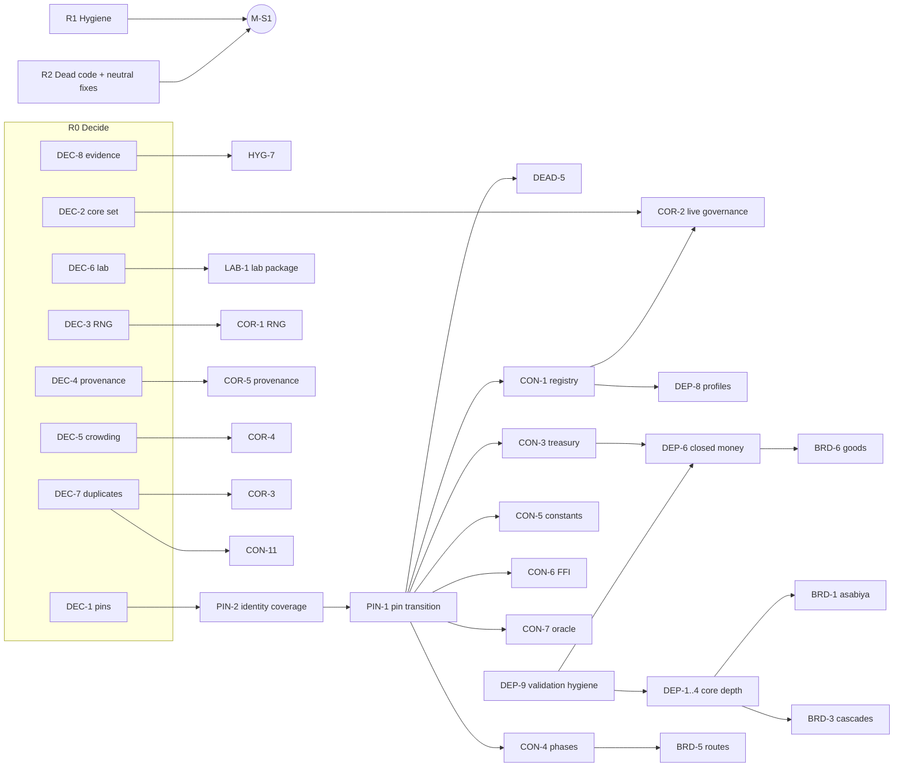

# Streamline and deepen — roadmap (2026-11)

> **Status:** Proposed. ENV-1, ENV-2, ENV-3 and ENV-8 are in review; no other task has started.
> **Date:** 2026-11-08
> **Source:** [repository scout and streamlining plan](../audits/2026-11-08-streamlining-scout.md) and its [32 area reports](../audits/2026-11-08-scout/)
> **Board:** [`progress/streamline-and-deepen.json`](../progress/streamline-and-deepen.json). Statuses: `ready` (no unmet prerequisite), `blocked` (waits on `depends_on`), `proposed` (owner decision or R7 brief), `review`.
> **Machines:** the 9950X and 3950X Linux workstations ([setup guide](../../workstations.md)).
> **Specs and plans:** `docs/superpowers/specs/2026-11-08-*-design.md` and `docs/superpowers/plans/2026-11-08-*.md` (index below)

## Owner instruction

Streamline the codebase:
- remove unneeded or buggy code;
- consolidate duplicated code;
- refactor anything that blocks expansion.

Then make Chronicler a grand, broad, wide and detailed simulation. This roadmap orders that work so that each step makes the next one cheaper and none of them quietly changes outcomes.

## How to use this roadmap

1. **Owner decisions come first (R0).**
   - Each decision record is in the spec named on its row.
   - R1 and R2 need no decision and can start now.
   - Most of R5 waits for DEC-1, because the files it consolidates pin their own source bytes.
2. **Change classes are kept apart.** Every PR is exactly one of:

   | Class | What it is | Gate |
   |---|---|---|
   | removal or refactor | Behaviour-preserving. | `scripts/turn_speed_identity.py compare` reports identical; the affected focused tests, the oracle lane, native tests and viewer tests pass; `refactor_preflight.py --git-diff origin/main` shows no unhandled pin. |
   | fix | Behaviour-neutral for every valid run. | The same gate as a refactor, plus a regression test for the bug. |
   | correction | An intentional outcome change. | A before/after baseline, a CONTINUATION entry and owner sign-off where a DEC applies. Never mixed with a refactor. |
   | feature | A new mechanism. | Default-off, with its own switch, a held evaluation design and the 200-seed gate before any default promotion. |
3. **One PR per numbered block in a plan.** Each plan lists its file map, steps and verification commands. Run the preflight before touching a file, and never rewrite a pinned hash.
4. **Ledger.** Update the board status and add a CONTINUATION entry when a PR merges. Never record an unrun gate as passed.

## Milestones and exit criteria

| Milestone | Phases | Done when (measured, not asserted) |
|---|---|---|
| **M-S1 Lean and honest** | R1, R2 | At least one workstation environment is set up per `docs/workstations.md` and has a receipt. Its local full gate is compared with CI run 42491150017, and the identity matrix is recorded. One current-status source. Unpinned dead code removed (about 2,650 source lines). The unpinned fixes merged with regression tests. FIX-1, FIX-3, FIX-10 and FIX-11 follow PIN-1. CI critical path shortened by the shard rebalance. `cloud_setup.sh` fails loudly. |
| **M-S2 Refactorable** | R0, R3 | DEC-1–DEC-8 recorded. Current-source enforced pins go from 84 files to the policy's target. Under option A, witnesses read committed frozen copies (about 91 files, 2.75 MB), so every former chain still verifies offline. The identity gate covers the formerly pinned modules (PIN-2 inventory complete). |
| **M-S3 Correct** | R4 | COR-1–COR-10 merged, each with its baseline. The provenance decision-read guard list is empty. A PYTHONHASHSEED sweep test is green. Live and CLI produce the same defaults. |
| **M-S4 Extensible** | R5 | `src/chronicler` contains no lab-only module. Adding a default-off switch touches one module, one state class and one registry row. That count is measured before CON-1 and again after CON-2. `run_turn_result` hooks come from the phase registry. Python↔Rust constants have one source. |
| **M-S5 Deep core** | R6 | Measured on held seeds against the 2026-11-08 baseline: culture at cap in under 25% of civ-turns (now 73–84%); military-zero share and war share of actions move off the floor; famine episodes produce named events; no named-event type above 20% (now 34–42%); aggregate inequality is non-zero; the closed-money identity holds every turn when enabled; household welfare primaries are in every screen. |
| **M-S6 Grand** | R7 | Each breadth mechanism is merged default-off with a held evaluation. Promotion of any of them follows the 200-seed gate. |

## Dependency graph

## Specs and plans

| Workstream | Tasks | Spec | Plan |
|---|---|---|---|
| Workstation environments | ENV-1–ENV-8 | [spec](../specs/2026-11-08-workstation-environments-design.md) | [plan](../plans/2026-11-08-workstation-environments.md) |
| Repository hygiene | HYG-1–HYG-8, DEC-8 | [spec](../specs/2026-11-08-repo-hygiene-design.md) | [plan](../plans/2026-11-08-repo-hygiene.md) |
| Dead-code removal | DEAD-2, DEAD-3, DEAD-5 | [spec](../specs/2026-11-08-dead-code-removal-design.md) | [plan](../plans/2026-11-08-dead-code-removal.md) |
| Behaviour-neutral fixes | FIX-1–FIX-7, FIX-9–FIX-13 | [spec](../specs/2026-11-08-behaviour-neutral-fixes-design.md) | [plan](../plans/2026-11-08-behaviour-neutral-fixes.md) |
| RNG hygiene and defaults registry | COR-1, COR-2, COR-9, CON-1, DEC-2, DEC-3 | [spec](../specs/2026-11-08-rng-and-defaults-design.md) | [plan](../plans/2026-11-08-rng-and-defaults.md) |
| Behaviour corrections | COR-3–COR-8, DEC-4, DEC-5, DEC-7 | [spec](../specs/2026-11-08-behaviour-corrections-design.md) | [plan](../plans/2026-11-08-behaviour-corrections.md) |
| Pin-policy transition | PIN-1, PIN-2, DEC-1 | [spec](../specs/2026-11-08-pin-policy-transition-design.md) | [plan](../plans/2026-11-08-pin-policy-transition.md) |
| Lab package relocation | LAB-1, DEC-6 | [spec](../specs/2026-11-08-lab-package-relocation-design.md) | [plan](../plans/2026-11-08-lab-package-relocation.md) |
| Switch-state base | CON-2, CON-10, CON-13, CON-14 | [spec](../specs/2026-11-08-switch-state-base-design.md) | [plan](../plans/2026-11-08-switch-state-base.md) |
| Turn-loop consolidation | CON-3, CON-4, CON-11, COR-10 | [spec](../specs/2026-11-08-turn-loop-consolidation-design.md) | [plan](../plans/2026-11-08-turn-loop-consolidation.md) |
| Rust and cross-language | CON-5, CON-6, CON-7 | [spec](../specs/2026-11-08-rust-cross-language-consolidation-design.md) | [plan](../plans/2026-11-08-rust-cross-language-consolidation.md) |
| Viewer streamlining | DEAD-1, DEAD-4, FIX-8, CON-9 | [spec](../specs/2026-11-08-viewer-streamlining-design.md) | [plan](../plans/2026-11-08-viewer-streamlining.md) |
| Core-loop depth | DEP-1–DEP-5 | [spec](../specs/2026-11-08-core-loop-depth-design.md) | [plan](../plans/2026-11-08-core-loop-depth.md) |
| Economy depth and measurement | DEP-6–DEP-9, CON-8 | [spec](../specs/2026-11-08-economy-depth-and-measurement-design.md) | [plan](../plans/2026-11-08-economy-depth-and-measurement.md) |

## Suggested execution order

0. **First, set up a workstation (ENV-1–ENV-6).**
   - Follow [docs/workstations.md](../../workstations.md) on the 9950X or the 3950X (both Linux).
   - Record the machine receipt and the identity matrix.
   - Reproduce CI's full gate locally.
   - The workstation then runs every later lane and gate in minutes. ENV-2–ENV-4 are small tooling PRs that need no decision.
1. **Now, in parallel:**
   - R1: HYG-1–HYG-6 and HYG-8.
   - R2: DEAD-1–DEAD-4, then the unpinned fixes (FIX-2, FIX-4–FIX-9, FIX-12, FIX-13). FIX-1, FIX-3, FIX-10 and FIX-11 touch pinned files, so they take an exact-inverse layer or wait for PIN-1.
   - DEP-9, so the evaluation tooling is ready before any depth work.
   - The owner records DEC-1–DEC-8.
2. **After DEC-1:**
   - PIN-2, then PIN-1.
   - Then DEAD-5, CON-1, CON-3–CON-7, CON-10 and CON-11 in that order. The PIN-2 identity gate shows each step identical.
   - LAB-1 after DEC-6.
3. **Corrections (R4), one PR each, after their decision:**
   - COR-6, COR-7, COR-9 and COR-10 need no decision. COR-8 needs PIN-1.
   - COR-1 waits for DEC-3, and COR-2 for DEC-2 and CON-1.
   - COR-3, COR-4 and COR-5 wait for their decisions.
4. **Deep core (R6):**
   - DEP-5 and DEP-7 first, because they are measurement.
   - Then DEP-8 (profiles), DEP-1–DEP-4 (DEP-2 after COR-6), and DEP-6 after CON-3.
5. **Breadth (R7):** each BRD item becomes its own spec when its prerequisites merge.

## Task list

### R0 — Decide

_Owner decisions D1–D8 recorded._

| ID | Task | Class | Depends on | Risk | Size | Spec | Plan |
|---|---|---|---|---|---|---|---|
| DEC-1 | Pin policy: freeze witness lane (A), keep (B) or scoped (C) | decision | — | - | - | [spec](../specs/2026-11-08-pin-policy-transition-design.md) | [plan](../plans/2026-11-08-pin-policy-transition.md) |
| DEC-2 | Name the 17 default-on systems the production core (governance/fisheries stay on?) | decision | — | - | - | [spec](../specs/2026-11-08-rng-and-defaults-design.md) | [plan](../plans/2026-11-08-rng-and-defaults.md) |
| DEC-3 | Sign off one aggregate RNG hygiene correction | decision | — | - | - | [spec](../specs/2026-11-08-rng-and-defaults-design.md) | [plan](../plans/2026-11-08-rng-and-defaults.md) |
| DEC-4 | Provenance must not decide outcomes: approve per-read corrections | decision | — | - | - | [spec](../specs/2026-11-08-behaviour-corrections-design.md) | [plan](../plans/2026-11-08-behaviour-corrections.md) |
| DEC-5 | New public-health enables default to density_only | decision | — | - | - | [spec](../specs/2026-11-08-behaviour-corrections-design.md) | [plan](../plans/2026-11-08-behaviour-corrections.md) |
| DEC-6 | Move detached harnesses to a lab package (name, shim lifetime) | decision | — | - | - | [spec](../specs/2026-11-08-lab-package-relocation-design.md) | [plan](../plans/2026-11-08-lab-package-relocation.md) |
| DEC-7 | Duplicate models: era-advance cost rule, legacy war kernel scope, formation fallback | decision | — | - | - | [spec](../specs/2026-11-08-behaviour-corrections-design.md) | [plan](../plans/2026-11-08-behaviour-corrections.md) |
| DEC-8 | Which evidence (logs, jsonl, held output) may leave git | decision | — | - | - | [spec](../specs/2026-11-08-repo-hygiene-design.md) | [plan](../plans/2026-11-08-repo-hygiene.md) |

### R1 — Hygiene and workstations

_One status source, clean ignore rules, CI and setup hardened, dead scripts archived; the 9950X/3950X workstations set up, measured and able to run every lane and the full gate._

| ID | Task | Class | Depends on | Risk | Size | Spec | Plan |
|---|---|---|---|---|---|---|---|
| ENV-1 | Workstation setup guide (docs/workstations.md, Linux-first) and links | docs | — | low | +250 doc lines | [spec](../specs/2026-11-08-workstation-environments-design.md) | [plan](../plans/2026-11-08-workstation-environments.md) |
| ENV-2 | Machine receipt: check_python_env.py --machine (with --json) | tooling | — | low | ~+150 | [spec](../specs/2026-11-08-workstation-environments-design.md) | [plan](../plans/2026-11-08-workstation-environments.md) |
| ENV-3 | Parallel oracle lane: run_python_oracle_checks.py --jobs N (default serial) | tooling | — | med | ~+80 | [spec](../specs/2026-11-08-workstation-environments-design.md) | [plan](../plans/2026-11-08-workstation-environments.md) |
| ENV-4 | Parallel batches: spawn pool with PYTHONHASHSEED 0 (lower priority on Linux: fork inherits the seed) | fix | — | low | ~+15 | [spec](../specs/2026-11-08-workstation-environments-design.md) | [plan](../plans/2026-11-08-workstation-environments.md) |
| ENV-5 | Cross-machine identity matrix (9950X, 3950X, CI-like Ubuntu) | measurement | ENV-1 | low | record | [spec](../specs/2026-11-08-workstation-environments-design.md) | [plan](../plans/2026-11-08-workstation-environments.md) |
| ENV-6 | Local full validation gate vs CI run 42491150017 at c3d752fa | measurement | ENV-1 | med | record | [spec](../specs/2026-11-08-workstation-environments-design.md) | [plan](../plans/2026-11-08-workstation-environments.md) |
| ENV-7 | Native build tuning (jemalloc on Linux, x86-64-v3) behind identity compare | perf | ENV-5 | low | record | [spec](../specs/2026-11-08-workstation-environments-design.md) | [plan](../plans/2026-11-08-workstation-environments.md) |
| ENV-8 | Agent-session notes for workstations (AGENTS.md, guide) | docs | — | low | small | [spec](../specs/2026-11-08-workstation-environments-design.md) | [plan](../plans/2026-11-08-workstation-environments.md) |
| HYG-1 | One current-status block; split CONTINUATION history | docs | — | low | ~2,000 lines moved | [spec](../specs/2026-11-08-repo-hygiene-design.md) | [plan](../plans/2026-11-08-repo-hygiene.md) |
| HYG-2 | .gitignore additions | config | — | low | small | [spec](../specs/2026-11-08-repo-hygiene-design.md) | [plan](../plans/2026-11-08-repo-hygiene.md) |
| HYG-3 | Archive superseded audits; fix stale docs | docs | — | low | ~3,100 md lines archived | [spec](../specs/2026-11-08-repo-hygiene-design.md) | [plan](../plans/2026-11-08-repo-hygiene.md) |
| HYG-4 | CI: concurrency group, toolchain 1.85, SHA action pins | ci | — | low | small | [spec](../specs/2026-11-08-repo-hygiene-design.md) | [plan](../plans/2026-11-08-repo-hygiene.md) |
| HYG-5 | cloud_setup.sh reports failures (non-zero only with CHRONICLER_SETUP_STRICT=1) | tooling | — | low | small | [spec](../specs/2026-11-08-repo-hygiene-design.md) | [plan](../plans/2026-11-08-repo-hygiene.md) |
| HYG-6 | Archive 15 doc-only scripts; index the pinned workflows (wealth_floor and duplicate workflows stay) | tooling | — | low | ~2,700 lines archived | [spec](../specs/2026-11-08-repo-hygiene-design.md) | [plan](../plans/2026-11-08-repo-hygiene.md) |
| HYG-7 | Move logs/jsonl/held output out of git | docs | DEC-8 | med | ~6 MB | [spec](../specs/2026-11-08-repo-hygiene-design.md) | [plan](../plans/2026-11-08-repo-hygiene.md) |
| HYG-8 | Rebalance native shards by recorded duration (160 later-added modules movable) | ci | — | med | up to ~7 min CI | [spec](../specs/2026-11-08-repo-hygiene-design.md) | [plan](../plans/2026-11-08-repo-hygiene.md) |

### R2 — Safe removal and neutral fixes

_Unpinned dead code gone; behaviour-neutral bugs fixed._

| ID | Task | Class | Depends on | Risk | Size | Spec | Plan |
|---|---|---|---|---|---|---|---|
| DEAD-1 | Delete 9 legacy viewer components (+tests, d3-force) | removal | — | low | -2,096 (+440 test) | [spec](../specs/2026-11-08-viewer-streamlining-design.md) | [plan](../plans/2026-11-08-viewer-streamlining.md) |
| DEAD-2 | Delete unpinned dead/test-only Python symbols | removal | — | low | ~-300 (+216 analytics, owner call) | [spec](../specs/2026-11-08-dead-code-removal-design.md) | [plan](../plans/2026-11-08-dead-code-removal.md) |
| DEAD-3 | Delete or cfg(test) unpinned dead Rust symbols | removal | — | low | ~-230 | [spec](../specs/2026-11-08-dead-code-removal-design.md) | [plan](../plans/2026-11-08-dead-code-removal.md) |
| DEAD-4 | Delete dead viewer exports; narrow module exports | removal | — | low | ~-30 | [spec](../specs/2026-11-08-viewer-streamlining-design.md) | [plan](../plans/2026-11-08-viewer-streamlining.md) |
| FIX-1 | Live int parsing: OverflowError on Infinity | fix | PIN-1 | low | small | [spec](../specs/2026-11-08-behaviour-neutral-fixes-design.md) | [plan](../plans/2026-11-08-behaviour-neutral-fixes.md) |
| FIX-2 | Food residual regression test (bug retracted: CAPTURED moves ownership only) | test | — | low | small | [spec](../specs/2026-11-08-behaviour-neutral-fixes-design.md) | [plan](../plans/2026-11-08-behaviour-neutral-fixes.md) |
| FIX-3 | Shared transient clear on all agent modes | fix | PIN-1 | low | small | [spec](../specs/2026-11-08-behaviour-neutral-fixes-design.md) | [plan](../plans/2026-11-08-behaviour-neutral-fixes.md) |
| FIX-4 | Tuning record files load or refuse clearly | fix | — | low | small | [spec](../specs/2026-11-08-behaviour-neutral-fixes-design.md) | [plan](../plans/2026-11-08-behaviour-neutral-fixes.md) |
| FIX-5 | Historiography sidecar durability (fsync, unique temp, cleanup) | fix | — | low | small | [spec](../specs/2026-11-08-behaviour-neutral-fixes-design.md) | [plan](../plans/2026-11-08-behaviour-neutral-fixes.md) |
| FIX-6 | Rust money path: Err not panic; total comparators | fix | — | low | small | [spec](../specs/2026-11-08-behaviour-neutral-fixes-design.md) | [plan](../plans/2026-11-08-behaviour-neutral-fixes.md) |
| FIX-7 | Livelihoods orphan-mode, saved-mode and _on() checks | fix (CLI acceptance) | — | med | ~-30 net | [spec](../specs/2026-11-08-behaviour-neutral-fixes-design.md) | [plan](../plans/2026-11-08-behaviour-neutral-fixes.md) |
| FIX-8 | Viewer WebSocket guard, lint script, declared deps | fix | — | low | small | [spec](../specs/2026-11-08-viewer-streamlining-design.md) | [plan](../plans/2026-11-08-viewer-streamlining.md) |
| FIX-9 | LLM clients: timeouts, truncation, budget | fix | — | low | small | [spec](../specs/2026-11-08-behaviour-neutral-fixes-design.md) | [plan](../plans/2026-11-08-behaviour-neutral-fixes.md) |
| FIX-10 | Live server start failure and event-loop blocking | fix | PIN-1 | med | small | [spec](../specs/2026-11-08-behaviour-neutral-fixes-design.md) | [plan](../plans/2026-11-08-behaviour-neutral-fixes.md) |
| FIX-11 | Live set command: unhashable stat crashes live | fix | PIN-1 | low | small | [spec](../specs/2026-11-08-behaviour-neutral-fixes-design.md) | [plan](../plans/2026-11-08-behaviour-neutral-fixes.md) |
| FIX-12 | Languages sidecar durability (same as FIX-5) | fix | — | low | small | [spec](../specs/2026-11-08-behaviour-neutral-fixes-design.md) | [plan](../plans/2026-11-08-behaviour-neutral-fixes.md) |
| FIX-13 | Total comparator at behavior.rs:91 | fix | — | low | small | [spec](../specs/2026-11-08-behaviour-neutral-fixes-design.md) | [plan](../plans/2026-11-08-behaviour-neutral-fixes.md) |

### R3 — Pin transition

_Refactors gated by behaviour, not source bytes; history still verifiable._

| ID | Task | Class | Depends on | Risk | Size | Spec | Plan |
|---|---|---|---|---|---|---|---|
| DEAD-5 | Dead code inside enforced-pinned files | removal | PIN-1 | med | ~-135 | [spec](../specs/2026-11-08-dead-code-removal-design.md) | [plan](../plans/2026-11-08-dead-code-removal.md) |
| PIN-2 | Identity-gate coverage for witness-pinned code | tooling | DEC-1 | med | new cases | [spec](../specs/2026-11-08-pin-policy-transition-design.md) | [plan](../plans/2026-11-08-pin-policy-transition.md) |
| PIN-1 | Pin-policy transition (D1 option A: witnesses read committed frozen copies) | policy+tooling | DEC-1, PIN-2 | med | +2.75 MB frozen copies | [spec](../specs/2026-11-08-pin-policy-transition-design.md) | [plan](../plans/2026-11-08-pin-policy-transition.md) |

### R4 — Corrections

_Each verified outcome bug fixed in its own baselined, signed-off PR._

| ID | Task | Class | Depends on | Risk | Size | Spec | Plan |
|---|---|---|---|---|---|---|---|
| COR-1 | RNG hygiene correction (system_rng, EXPAND seed, additive seeds, seed-0 food order, hash-seed sweep) | correction | DEC-3 | high | baseline; pinned wave after PIN-1 | [spec](../specs/2026-11-08-rng-and-defaults-design.md) | [plan](../plans/2026-11-08-rng-and-defaults.md) |
| COR-2 | Governance default for live worlds | correction | DEC-2, CON-1 | med | small | [spec](../specs/2026-11-08-rng-and-defaults-design.md) | [plan](../plans/2026-11-08-rng-and-defaults.md) |
| COR-3 | Scholarship emit order and one era-cost rule | correction | DEC-7 | med | small | [spec](../specs/2026-11-08-behaviour-corrections-design.md) | [plan](../plans/2026-11-08-behaviour-corrections.md) |
| COR-4 | Health crowding default for new enables | correction | DEC-5 | low | small | [spec](../specs/2026-11-08-behaviour-corrections-design.md) | [plan](../plans/2026-11-08-behaviour-corrections.md) |
| COR-5 | Remove provenance decision reads (one PR each) | correction | DEC-4, PIN-1 | high | 7 PRs | [spec](../specs/2026-11-08-behaviour-corrections-design.md) | [plan](../plans/2026-11-08-behaviour-corrections.md) |
| COR-6 | War event and casualty accounting | correction | — | med | small | [spec](../specs/2026-11-08-behaviour-corrections-design.md) | [plan](../plans/2026-11-08-behaviour-corrections.md) |
| COR-7 | Politics step-11 authority (Rust vs Python) | correction | — | med | ~-140 | [spec](../specs/2026-11-08-behaviour-corrections-design.md) | [plan](../plans/2026-11-08-behaviour-corrections.md) |
| COR-8 | Explicit hills ecology row + parity, unread tuning keys, single TITHE_RATE literal | correction | PIN-1 | low | small | [spec](../specs/2026-11-08-behaviour-corrections-design.md) | [plan](../plans/2026-11-08-behaviour-corrections.md) |
| COR-9 | Rust stable_hash_int repr parity with Python | correction | — | low | small | [spec](../specs/2026-11-08-rng-and-defaults-design.md) | [plan](../plans/2026-11-08-rng-and-defaults.md) |
| COR-10 | gp_agendas projected treasury ignores the accumulator watermark | correction | — | med | small | [spec](../specs/2026-11-08-turn-loop-consolidation-design.md) | [plan](../plans/2026-11-08-turn-loop-consolidation.md) |

### R5 — Relocate and consolidate

_Lab code out of the package; adding a system touches one module and one registry._

| ID | Task | Class | Depends on | Risk | Size | Spec | Plan |
|---|---|---|---|---|---|---|---|
| LAB-1 | Move 27 lab-only modules to chronicler_lab with sys.modules shims | relocation | DEC-6 | med | ~13k moved | [spec](../specs/2026-11-08-lab-package-relocation-design.md) | [plan](../plans/2026-11-08-lab-package-relocation.md) |
| CON-1 | One defaults and switch registry (main, live, catalog, batch) | refactor | PIN-1 | med | ~-170 | [spec](../specs/2026-11-08-rng-and-defaults-design.md) | [plan](../plans/2026-11-08-rng-and-defaults.md) |
| CON-2 | SwitchState base for *_state modules | refactor | — | med | ~-400 | [spec](../specs/2026-11-08-switch-state-base-design.md) | [plan](../plans/2026-11-08-switch-state-base.md) |
| CON-3 | Treasury seam and acc-route helper | refactor | PIN-1 | med | ~-100 | [spec](../specs/2026-11-08-turn-loop-consolidation-design.md) | [plan](../plans/2026-11-08-turn-loop-consolidation.md) |
| CON-4 | Phase registry for run_turn_result hooks | refactor | PIN-1 | high | ~-150 | [spec](../specs/2026-11-08-turn-loop-consolidation-design.md) | [plan](../plans/2026-11-08-turn-loop-consolidation.md) |
| CON-5 | Single source for Python<->Rust constants | refactor | PIN-1 | med | ~-60 | [spec](../specs/2026-11-08-rust-cross-language-consolidation-design.md) | [plan](../plans/2026-11-08-rust-cross-language-consolidation.md) |
| CON-6 | FFI generics, ffi/mod.rs split; economy.rs wrapper merge optional | refactor | PIN-1 | med | ~-200 | [spec](../specs/2026-11-08-rust-cross-language-consolidation-design.md) | [plan](../plans/2026-11-08-rust-cross-language-consolidation.md) |
| CON-7 | compute_economy becomes a test oracle | refactor | PIN-1 | med | ~800 moved | [spec](../specs/2026-11-08-rust-cross-language-consolidation-design.md) | [plan](../plans/2026-11-08-rust-cross-language-consolidation.md) |
| CON-8 | Frozen-screen evidence hash test and docs (runner already unified) | tooling | — | low | ~0 | [spec](../specs/2026-11-08-economy-depth-and-measurement-design.md) | [plan](../plans/2026-11-08-economy-depth-and-measurement.md) |
| CON-9 | Viewer primitives; AppShell helpers and memoisation | refactor | — | med | ~-900 to -1,300 | [spec](../specs/2026-11-08-viewer-streamlining-design.md) | [plan](../plans/2026-11-08-viewer-streamlining.md) |
| CON-10 | Table-driven build_signals validation | refactor | PIN-1 | low | ~-50 | [spec](../specs/2026-11-08-switch-state-base-design.md) | [plan](../plans/2026-11-08-switch-state-base.md) |
| CON-11 | Python formation fallback removed or test-flagged | refactor | DEC-7, PIN-1 | med | ~-250 | [spec](../specs/2026-11-08-turn-loop-consolidation-design.md) | [plan](../plans/2026-11-08-turn-loop-consolidation.md) |
| CON-13 | Opt-in default fill for state classes without __setstate__ | correction | CON-2 | med | small | [spec](../specs/2026-11-08-switch-state-base-design.md) | [plan](../plans/2026-11-08-switch-state-base.md) |
| CON-14 | Shuffle helper, cities/agent_movements twins, proven-identical _controller | refactor | CON-2 | low | ~-100 | [spec](../specs/2026-11-08-switch-state-base-design.md) | [plan](../plans/2026-11-08-switch-state-base.md) |

### R6 — Deep core

_Core stats carry information, money is conserved, welfare is measured, runs are reproducible by profile._

| ID | Task | Class | Depends on | Risk | Size | Spec | Plan |
|---|---|---|---|---|---|---|---|
| DEP-9 | Validation hygiene (seed registry enforcement, multiple comparison, hash-seed sweep, nightly smoke) | tooling | — | med | tooling | [spec](../specs/2026-11-08-economy-depth-and-measurement-design.md) | [plan](../plans/2026-11-08-economy-depth-and-measurement.md) |
| DEP-8 | Feature profiles (--feature-profile) | feature (tooling) | CON-1, PIN-1 | low | small | [spec](../specs/2026-11-08-economy-depth-and-measurement-design.md) | [plan](../plans/2026-11-08-economy-depth-and-measurement.md) |
| DEP-7 | Household welfare and access metrics | measurement | — | med | medium | [spec](../specs/2026-11-08-economy-depth-and-measurement-design.md) | [plan](../plans/2026-11-08-economy-depth-and-measurement.md) |
| DEP-5 | Aggregate inequality metric | measurement | — | low | small | [spec](../specs/2026-11-08-core-loop-depth-design.md) | [plan](../plans/2026-11-08-core-loop-depth.md) |
| DEP-1 | Saturating culture/economy/asabiya | feature | DEP-9, PIN-1 | high | medium | [spec](../specs/2026-11-08-core-loop-depth-design.md) | [plan](../plans/2026-11-08-core-loop-depth.md) |
| DEP-2 | Military stock and mustering | feature | DEP-9, PIN-1, COR-6 | high | medium | [spec](../specs/2026-11-08-core-loop-depth-design.md) | [plan](../plans/2026-11-08-core-loop-depth.md) |
| DEP-3 | Famine episodes and named events | feature | DEP-9, PIN-1 | med | medium | [spec](../specs/2026-11-08-core-loop-depth-design.md) | [plan](../plans/2026-11-08-core-loop-depth.md) |
| DEP-4 | Named-event generator balance | feature | DEP-9, PIN-1 | med | small | [spec](../specs/2026-11-08-core-loop-depth-design.md) | [plan](../plans/2026-11-08-core-loop-depth.md) |
| DEP-6 | Closed money supply | feature | CON-3, DEP-9, PIN-1 | high | large | [spec](../specs/2026-11-08-economy-depth-and-measurement-design.md) | [plan](../plans/2026-11-08-economy-depth-and-measurement.md) |

### R7 — Breadth

_New mechanisms on the consolidated core, each default-off and gated._

| ID | Task | Class | Depends on | Risk | Size | Spec | Plan |
|---|---|---|---|---|---|---|---|
| CON-12 | Family merges (upkeep, care, teaching, forest, transfers) | refactor | CON-2, CON-4 | high | unverified | roadmap brief | — |
| BRD-1 | Per-region asabiya (M55b) | feature | DEP-1 | high | brief | roadmap brief | — |
| BRD-2 | Commons and exploitation (M64) | feature | DEP-7 | high | brief | roadmap brief | — |
| BRD-3 | Revolution cascades on knowledge packets (M70) | feature | DEP-1 | high | brief | roadmap brief | — |
| BRD-4 | Beliefs, decay and deception (M71) | feature | — | high | brief | roadmap brief | — |
| BRD-5 | Routes, roads and settlement hierarchy | feature | CON-4 | high | brief | roadmap brief | — |
| BRD-6 | Goods, per-good prices and craft chains | feature | DEP-6, CON-5 | high | brief | roadmap brief | — |
| BRD-7 | Age structure and demography | feature | — | high | brief | roadmap brief | — |
| BRD-8 | Technology diffusion across controllers | feature | — | med | brief | roadmap brief | — |
| BRD-9 | World-generation variety (regions, civ templates, traits) | feature | — | med | brief | roadmap brief | — |
| BRD-10 | Scale: M61b validation, Morton order, incremental IdSlots, u16 widening | perf | PIN-1 | high | brief | roadmap brief | — |
| BRD-11 | Viewer for grand runs (zoomable timeline, map pan/zoom, turn diff, export) | feature | CON-9 | med | brief | roadmap brief | — |

## R7 breadth briefs

These are not specs yet. Each brief says what the mechanism is, the code it builds on, and the first question its evaluation must answer. Write the full spec once its prerequisites have merged. Every item ships default-off.

- **BRD-1 Per-region asabiya (M55b).**
  - **Today:** `simulation.py:753–758` applies one civ-wide delta to every region.
  - **Change:** regional asabiya driven by frontier exposure, distance to the capital and recent conquest. Civ asabiya becomes a population-weighted mean.
  - **First question:** does overextension appear (cohesion lower at the periphery, secessions concentrated there) without changing how often civilizations collapse?
- **BRD-2 Commons and exploitation (M64).**
  - **Today:** `governance_measurements.py:902–908` records "no M64 commons kernel exists"; `commons_rules.py` is a livelihoods rule only.
  - **Change:** a commons stock per region, with extraction by agents and elites, regeneration, and an elite-commons amplifier feeding PSI.
  - **First question:** does overuse produce recoverable collapse cycles rather than permanent depletion?
- **BRD-3 Revolution cascades (M70).**
  - **Today:** revolts come only through PSI (`governance_runtime.py:250`).
  - **Change:** threshold cascades carried by the existing `knowledge.rs` information packets, so unrest spreads with information.
  - **First question:** does the size distribution of cascades become heavy-tailed while baseline revolt frequency stays bounded?
- **BRD-4 Beliefs, decay and deception (M71).**
  - **Today:** `intelligence.py` (the M24 layer) has perception with no belief state.
  - **Change:** per-civilization beliefs about others, with decay, and deception as an action. This builds on DEP-8 profiles for controlled comparisons.
  - **First question:** do wars of misjudgement appear, and does information quality predict war outcomes?
- **BRD-5 Routes, roads and settlement hierarchy.**
  - **Today:** trade follows adjacency only, and settlements have no ranks.
  - **Change:** routes as built infrastructure (reusing infrastructure condition), central-place ranks from `settlements.py`, and route-dependent transit cost.
  - **First question:** do trade networks form hubs, and does losing a hub propagate?
  - **Depends on:** CON-4, so the phases have a place to register.
- **BRD-6 Goods, prices and craft chains.**
  - **Today:** 9 goods with one price per category; craft is inert; resource arrays have 3 fixed slots and are FFI-pinned.
  - **Change:** per-good prices, a real craft chain (inputs to outputs), prime movers and fodder, domesticates and herds.
  - **Depends on:** DEP-6 (conserved money) and CON-5 (constants).
  - **First question:** do relative prices respond to shocks, with conserved money?
- **BRD-7 Age structure and demography.**
  - **Today:** the population and health model has no age structure, and fertility and mortality do not vary by age. Births enter as susceptible newcomers (`epidemiology.py` `_absorb_population`) [S-10].
  - **Change:** cohort bands that feed labour, military and dependency ratios.
  - **First question:** do famine and war leave visible cohort scars that later affect labour supply?
- **BRD-8 Technology diffusion across controllers.**
  - **Today:** techniques spread only within one controller.
  - **Change:** diffusion through contact-ledger channels and trade and war contact, with a lag.
  - **First question:** do technology frontiers emerge and close?
- **BRD-9 World-generation variety.**
  - **Today:** 12 template regions, 6 civilization templates and 10 traits.
  - **Change:** procedural scenarios, more templates and traits, and continuous terrain later.
  - **First question:** does outcome variance across worlds rise without producing degenerate worlds?
- **BRD-10 Scale.**
  - **Today:** the largest measured native peak is 53,138 agents. The Morton order is computed and then discarded (`spatial.rs:1363`). `IdSlots` is a dense rebuild at every use, and the `u16` culture weights and cell occupancy saturate.
  - **Change:** real M61b validation, either using the Morton order or deleting it, incremental `IdSlots`, and widened counters.
  - **First question:** do the 500k–1M agent runs fit the CI and cloud budgets?
- **BRD-11 Viewer for grand runs.**
  - **Today:** the atlas has no pan or zoom, and labels overlap beyond about 100 regions. The timeline maps the whole run to one track.
  - **Change:** a zoomable timeline with era marks, a turning-point strip across systems, a same-run turn-versus-turn diff, and CSV export.
  - **Depends on:** CON-9.
- **CON-12 Family merges.**
  - **Change:** after CON-2 and CON-4, merge these switch families, keeping every flag and saved field as an alias:
    - **Upkeep:** `maintenance_obligation`, `operating_wear`, `infrastructure_condition`, `repair_projects`, `recovery_crews`, `infrastructure_crews`.
    - **Care:** `health_care`, `epidemic_care`, `public_health`, `quarantine_rules`.
    - **Teaching:** `learning_services` into `apprenticeship`.
    - **Forest:** `timber_*`, `harvest_cover`, `clearing_protection`, `commons_rules`.
    - **Transfers:** a fee primitive over `wealth_transfer.rs`.
  - **First question:** does each merged family reproduce the held results it replaces?

## What this roadmap does not claim

- No gate was run for this plan: not the oracle lane, native tests, viewer tests, lint or build, `turn_speed_identity`, or the 200-seed gate.
- Sizes are estimates from the audit. Specs refine them, and the PRs measure them.
- The connected-world configuration stays experimental and default-off. Nothing here promotes a feature.
